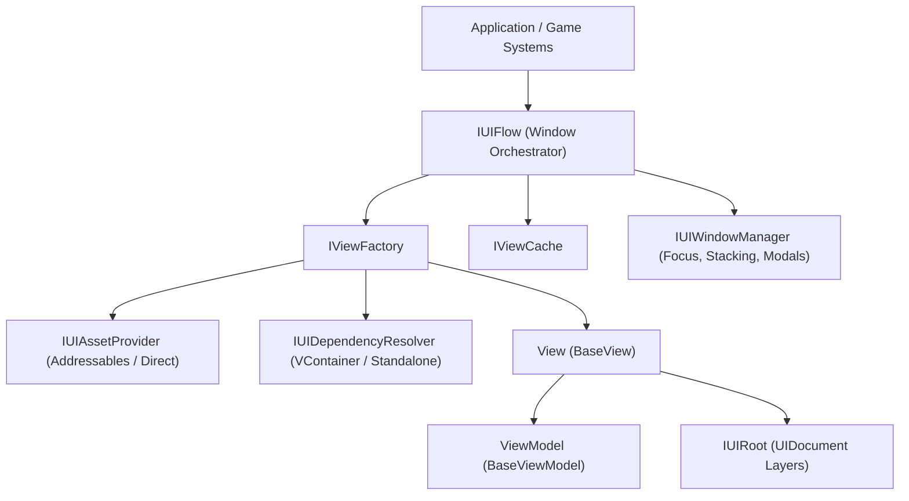

# 🏛️ SUIF Architecture Manual

> **SUIF (Scalable UI Framework)** is an ultra-performant, modular, declarative MVVM UI Toolkit framework engineered specifically for **Unity 6+**.

---

## 📐 High-Level Architecture Overview

---

## 🧱 Core Subsystems

### 1. MVVM, Optional Data Contracts & Separation of Concerns
* **Domain Services & `ScriptableObject`s**: Own all business logic, counters, catalogs, calculations, and parallel `UniTask.WhenAll` preloading.
* **Data Contracts (Optional)**: Any `readonly struct`, POCO `class`, or `ScriptableObject` representing UI state—zero forced dependency on `SUIF` interfaces.
* **Thin ViewModel (`BaseViewModel` / `IReactiveDataViewModel<TData>`)**: Pure C# POCO facade forwarding reactive streams and commands to Domain Services without calculations or UI strings.
* **Injectable Text Formatter (`Singleton`)**: Instance service pre-caching `FixedTextWriter<T>` delegates at startup to format data spans zero-alloc.
* **Thin View (`BaseReactiveDataView<TViewModel, TData>` / `BaseDataView<TViewModel, TData>` / `BaseView<TViewModel>`)**: Declares `[UQuery]` fields, registers `Binder.FixedSlot(...)` and `FixedElementPool<TElement>`, and receives DI formatters via `IUIDependencyResolver.Inject` (`[Inject]`).
* **Binding Layer (`ViewBinder`)**: Zero-allocation reactive bridge (`DataBindingExtensions.ToData`, `LabelBindingExtensions.ToFixedText` / `ToFixedWritten`).
* **Detailed Guide**: See [Universal Data & Zero-Realloc UI Architecture](DTO_Standard_And_ZeroAlloc_UI.md) and [AI Agent Specification](AI_Guidelines_DTO_And_ZeroAlloc.md).

### 2. Scoped Window Lifecycle & Layers
Windows are assigned to distinct layers via the `[UIView]` attribute:
* `UILayer.Background`: Underlays and background canvases.
* `UILayer.Screens`: Fullscreen views (HUD, Main Menu, Inventory screen).
* `UILayer.Windows`: Floating, stackable windows (Character stats, Quest log).
* `UILayer.Popups`: Modals, confirmation dialogs, alerts.
* `UILayer.Topmost`: Tooltips, notifications, loading spinners.

### 3. Focus & Modal Management
The `UIWindowManager` tracks window focus automatically:
* Brings clicked windows to the front within their respective layer.
* Manages `is-active` and `is-inactive` USS states for visual elevation.
* Automatically creates and animates `ModalBlocker` UXML overlays for modal views.

### 4. Dependency Inversion & Modularity
The framework isolates external dependencies using modular assembly definitions:
* **`SUIF.Core`**: Pure zero-dependency baseline.
* **`SUIF.VContainer`**: Activates automatically when `jp.hadashikick.vcontainer` is present.
* **`SUIF.Addressables`**: Activates automatically when `com.unity.addressables` is present.
* **`SUIF.R3`**: Activates reactive extensions when `R3` is available.
