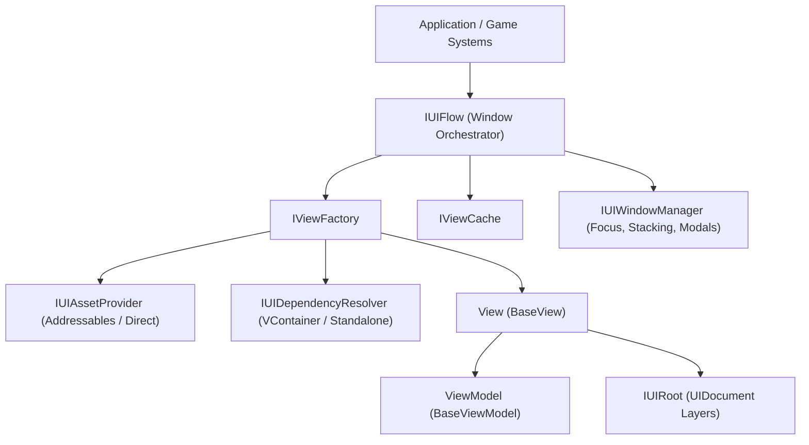

# 🏛️ SUIF Architecture Manual

> **SUIF (Scalable UI Framework)** is an ultra-performant, modular, declarative MVVM UI Toolkit framework engineered specifically for **Unity 6+**.

---

## 📐 High-Level Architecture Overview

---

## 🧱 Core Subsystems

### 1. MVVM, DTO Contracts & Separation of Concerns
* **DTO Contracts (`struct : IViewDto`)**: Pure immutable value-type state snapshots containing only domain primitives and enums—zero UI strings or `UIElements` dependencies.
* **ViewModel (`BaseViewModel`)**: Pure C# POCO classes containing domain state, commands, and `ReactiveProperty<TDto>` streams. Cleanly decoupled from UI formatting and CSS tokens.
* **Text Formatter (`FixedTextWriter<TState>`)**: Pure `ZString` formatters and zero-allocation `switch` expressions converting DTO values into formatted character spans.
* **View (`BaseDtoView<TViewModel, TDto>` / `BaseView<TViewModel>`)**: Pure UI Toolkit binding logic (`Binder.ToDto`), `FixedTextSlot` / `FixedSlotLabel` text slots, and `FixedElementPool<TElement>` DOM pools. Views are never MonoBehaviours!
* **Binding Layer (`ViewBinder`)**: Zero-allocation reactive bridge between ViewModel and View (`DtoBindingExtensions`, `LabelBindingExtensions`).
* **Detailed Guide**: See [DTO Standard & Zero-Realloc UI Architecture](DTO_Standard_And_ZeroAlloc_UI.md) and [AI Agent Specification](AI_Guidelines_DTO_And_ZeroAlloc.md).

### 2. Scoped Window Lifecycle & Layers
Windows are assigned to distinct layers via the `[UIView]` attribute:
* `UILayer.Background`: Underlays and background canvases.
* `UILayer.Screens`: Fullscreen views (HUD, Main Menu, Inventory screen).
* `UILayer.Windows`: Floating, stackable windows (Character stats, Quest log).
* `UILayer.Popups`: Modals, confirmation dialogs, alerts.
* `UILayer.Topmost`: Tooltips, notifications, loading spinners.

### 3. Focus & Modal Management
The `UIWindowManager` tracks window focus automatically:
* Brings clicked windows to the front within their respective layer.
* Manages `is-active` and `is-inactive` USS states for visual elevation.
* Automatically creates and animates `ModalBlocker` UXML overlays for modal views.

### 4. Dependency Inversion & Modularity
The framework isolates external dependencies using modular assembly definitions:
* **`SUIF.Core`**: Pure zero-dependency baseline.
* **`SUIF.VContainer`**: Activates automatically when `jp.hadashikick.vcontainer` is present.
* **`SUIF.Addressables`**: Activates automatically when `com.unity.addressables` is present.
* **`SUIF.R3`**: Activates reactive extensions when `R3` is available.
