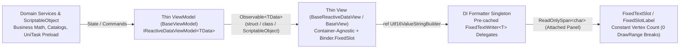

# SUIF Universal Data & Zero-Realloc UI Architecture

> **Status:** Official SUIF Framework Standard (`com.reenbo.suif`)
> **Target Engine:** Unity 6+ UI Toolkit (`UnityEngine.UIElements`)

---

## 1. Why This Architecture Exists

In typical MVVM UI codebases, three issues degrade maintainability and runtime performance:

1. **Bloated ViewModels & Hardcoded Statics:** Business math, circular buffers, timestamps, and `static` lookup arrays accumulate in ViewModels alongside display strings (`$"HP: {hp}/{maxHp}"`), making serialization, `ScriptableObject` configs, server structs, and preset/locale switching awkward.
2. **Rigid Data Constraints:** Forcing every UI payload to implement a framework-specific interface or `struct` prevents passing server payloads, POCOs, or local `ScriptableObject` assets directly.
3. **`AllocPage` Fragmentation in UI Toolkit:** Changing `Label.text` length alters font quad counts (`MeshHandle`), invalidating `AllocPage` buffer slots and splitting `DrawRange` batches (`12–46 DC` instead of `2–4 DC`).

SUIF solves all three cleanly: **optional universal `TData` contracts**, **Domain Services + Thin ViewModels + Thin Views**, **DI-injected instance Formatters** (zero static mutable/data state), and **fixed-capacity GPU text/pool primitives**.

---

## 2. Clean 5-Layer Pipeline



| Layer | Responsibility | Strictly Prohibited |
| :--- | :--- | :--- |
| **1. Data Models** (`struct`, `class`, `ScriptableObject`, `enum`) | Pure data snapshots or configs from server, DB, or ScriptableObject assets. Zero forced dependency on `SUIF`. | `UnityEngine.UIElements` references, pre-formatted UI strings, USS class names. |
| **2. Domain Services** (`Singleton` / `IShowcasePreloadable`) | Own all calculations, timers, lists, asset catalogs, and `UniTask.WhenAll` parallel preloading. | Manipulating UXML elements directly. |
| **3. Thin ViewModel** (`BaseViewModel` / `IReactiveDataViewModel<TData>`) | Pure reactive facade forwarding `Observable<TData>` / `ReadOnlyReactiveProperty<TData>` and commands to services. | Loops, arithmetic math, circular buffer logic, timestamps, `static` data arrays, UI strings. |
| **4. DI Formatter Service** (`Singleton`) | Instance service pre-allocating `FixedTextWriter<T>` delegates once in constructor + zero-alloc `switch` expressions for enum tokens. | Global `static` formatting state or per-update heap allocations. |
| **5. Thin View** (`BaseReactiveDataView<TViewModel, TData>` / `BaseView<TViewModel>`) | Declares `[UQuery]` fields, registers slots via `Binder.FixedSlot(...)` & `FixedElementPool<TElement>`, and binds purely against `ViewModel` (`ViewModel.Formatter` pass-through). | `[Inject]` / DI container dependencies, business calculations, copy-pasted slot setup, `container.Clear()` + `Add()` loops, raw dynamic `.text = $"..."`. |

---

## 3. Core SUIF Framework Primitives

### 3.1 Universal Constraint-Free Data Views & Bindings

Data contracts (`TData`) are **completely optional** and un-constrained—use `readonly struct`, reference `class`, or `ScriptableObject`:

* **`SUIF.Base.BaseDataView<TViewModel, TData>`**: Abstract view inheriting `BaseView<TViewModel>` with `protected abstract void RenderData(TData data)`.
* **`SUIF.R3.Base.IReactiveDataViewModel<TData>`** + **`BaseReactiveDataView<TViewModel, TData>`**: Optional reactive specialization that auto-subscribes `ViewModel.Data` (`Observable<TData>`) in `Bind()`, exposing clean `OnBind()` and `RenderData(TData data)` hooks without manual `Binder.ToData(...)` boilerplate.
* **`SUIF.R3.Extensions.DataBindingExtensions`**:
  * `Binder.ToData<TData>(Observable<TData> property, Action<TData> onChanged)`
  * `Binder.ToData<TData, TState>(Observable<TData> property, TState state, Action<TData, TState> onChanged)`
* **Container-Agnostic Views:** Views never depend on DI containers or `[Inject]`. Formatters (`ITextFormatter` Singletons) are injected into the `ViewModel` constructor and exposed read-only via `ViewModel.Formatter` for clean UI binding without View-side injection.

### 3.2 `ViewBinder.FixedSlot`, `FixedTextSlot` & `FixedSlotLabel`

Located in `SUIF.Binding` and `SUIF.Controls`:

* **`Binder.FixedSlot(TextElement element, int capacity = 32)`**: Centralized slot factory & disposal registration on `ViewBinder` (automatically reuses `FixedSlotLabel.Slot` if targeting a `FixedSlotLabel`), eliminating per-View helper boilerplate.
* **`FixedTextSlot`**: Wraps any `TextElement` with fixed character capacity (`capacity`):
  * Pads trailing capacity inside `<size=0.01>000...</size>` (tight layout width) and collapses padding glyph quads in `PostProcessTextVertices` (`alpha = 0`), preserving constant vertex/index counts (**0 `DrawRange` splits**).
  * **Deferred Panel Attach Flush**: When `SetText` is called while `_target.panel == null` (e.g., constructing detached pooled rows), writes stay buffered in `_buffer` and flush zero-alloc once `AttachToPanelEvent` fires—eliminating Unity's `"not attached to a panel. Falling back to string allocation"` warning and heap allocation.
* **`FixedSlotLabel`**: Drop-in UXML control (`[UxmlElement("FixedSlotLabel")]`, `IDisposable`) with `[UxmlAttribute("capacity")] int Capacity`.
* **`LabelBindingExtensions`**:
  * `Binder.Bind(element).ToFixedText(...)` (for `string`, `int`, `long`, `float`)
  * `Binder.Bind(element).ToFixedWritten<TElement, TData>(property, capacity, writer)` and `ToFixedWritten<TElement, TData, TState>(property, capacity, state, writer)` *(zero-closure, zero-`string.Format`)*.

### 3.3 `FixedElementPool<TElement>`

Located in `SUIF.Binding`:

* Pre-allocates `capacity` elements once during `Bind()` / `OnBind()` and toggles visibility with `DisplayStyle.None` via `Render(activeCount, ...)` and zero-closure `Render<TState>(activeCount, state, ...)`.
* Keep `DisplayStyle.None` rather than `Visibility.Hidden` for cached/inactive views (`Visibility.Hidden` retains transparent geometry and spiked Draw Calls `27 DC` vs `16 DC`).

---

## 4. Reference Implementation Pattern

### Step 1: Data Contract (Plain Struct, POCO, or `ScriptableObject`)
```csharp
public enum InventoryRarity : byte { Common, Rare, Legendary }

public readonly struct InventoryInspectorDto
{
    public readonly int ItemId;
    public readonly int PowerScore;
    public readonly InventoryRarity Rarity;

    public InventoryInspectorDto(int itemId, int powerScore, InventoryRarity rarity)
    {
        ItemId = itemId;
        PowerScore = powerScore;
        Rarity = rarity;
    }
}
```

### Step 2: Injectable Formatter Singleton (Zero Static State)
```csharp
using Cysharp.Text;
using SUIF.Binding;

public interface IInventoryTextFormatter
{
    FixedTextWriter<InventoryInspectorDto> PowerScore { get; }
    FixedTextWriter<InventoryRarity> RarityBadge { get; }
}

public sealed class InventoryTextFormatter : IInventoryTextFormatter
{
    public FixedTextWriter<InventoryInspectorDto> PowerScore { get; }
    public FixedTextWriter<InventoryRarity> RarityBadge { get; }

    public InventoryTextFormatter()
    {
        PowerScore = WritePowerScore;
        RarityBadge = WriteRarityBadge;
    }

    private void WritePowerScore(ref Utf16ValueStringBuilder sb, InventoryInspectorDto dto)
    {
        sb.Append('+');
        sb.Append(dto.PowerScore);
        sb.Append(" PWR");
    }

    private void WriteRarityBadge(ref Utf16ValueStringBuilder sb, InventoryRarity rarity)
    {
        sb.Append(rarity switch
        {
            InventoryRarity.Rare => "[RARE]",
            InventoryRarity.Legendary => "[LEGENDARY]",
            _ => "[COMMON]"
        });
    }
}
```

### Step 3: Thin ViewModel (`IReactiveDataViewModel<TData>`)
```csharp
using R3;
using SUIF.Base;
using SUIF.R3.Base;

public sealed class InventoryViewModel : BaseViewModel, IReactiveDataViewModel<InventoryInspectorDto>
{
    private readonly IInventoryService _inventoryService;

    public IInventoryTextFormatter Formatter { get; }
    public Observable<InventoryInspectorDto> Data => _inventoryService.State;

    public InventoryViewModel(IInventoryService inventoryService, IInventoryTextFormatter formatter)
    {
        _inventoryService = inventoryService;
        Formatter = formatter;
    }

    public void SelectSlot(int index) => _inventoryService.SelectSlot(index);
}
```

### Step 4: Thin View (`BaseReactiveDataView` + `Binder.FixedSlot`, Zero DI Imports)
```csharp
using SUIF.Attributes;
using SUIF.Binding;
using SUIF.R3.Base;
using UnityEngine.UIElements;

[UIView("InventoryView", SUIF.API.UILayer.Windows, UILoadingMode.Cached)]
public sealed class InventoryView : BaseReactiveDataView<InventoryViewModel, InventoryInspectorDto>
{
    [UQuery("lbl-rarity")] private Label _rarityLabel;
    [UQuery("lbl-power")] private Label _powerLabel;

    private FixedTextSlot _raritySlot;
    private FixedTextSlot _powerSlot;

    public InventoryView(VisualElement root) : base(root) { }

    protected override void OnBind()
    {
        _raritySlot = Binder.FixedSlot(_rarityLabel, 16);
        _powerSlot = Binder.FixedSlot(_powerLabel, 16);
    }

    protected override void RenderData(InventoryInspectorDto dto)
    {
        var formatter = ViewModel.Formatter;
        _raritySlot?.SetWritten(dto.Rarity, formatter.RarityBadge);
        _powerSlot?.SetWritten(dto, formatter.PowerScore);
    }
}
```

---

## 5. Async / Parallel Preloading With `LoadingSpinnerView`

For heavy catalogs or server fetches (`ScriptableObject` deserialization, `10k+` node arrays), inject preloadable services implementing a shared preload contract into an orchestrator using a pre-allocated `UniTask[]` buffer and `UniTask.WhenAll(...)`:

* Open a cached `LoadingSpinnerView` on `UILayer.Topmost` (`await _uiFlow.OpenAsync<LoadingSpinnerView>(ct)`).
* Run `await UniTask.WhenAll(_taskBuffer)` in parallel.
* Close cleanly inside `finally { _uiFlow.Close<LoadingSpinnerView>(); }`.
* Render spinner frames through `FixedTextSlot` (e.g. `[|]`, `[/]`, `[-]`, `[\]`) rather than rotated DOM transforms so the loading overlay adds zero stencil/matrix Draw Call overhead.

---

## 6. Anti-Patterns Checklist

* **NEVER** put arithmetic, loops, timestamps, or `static` data arrays inside a `ViewModel`—keep them in Domain Services or `ScriptableObject` assets.
* **NEVER** force domain structs/assets to implement framework marker interfaces (`TData` works with any `struct`, `class`, or `ScriptableObject`).
* **NEVER** duplicate `RegisterFixedSlot` helpers in Views—use `Binder.FixedSlot(element, capacity)`.
* **NEVER** create `static class *Formatter` globals with mutable formatting rules—use injectable Singleton formatters caching `FixedTextWriter<T>` delegates at startup.
* **NEVER** mutate dynamic `Label.text` directly or call `container.Clear()` + `new VisualElement()` on updates—use `FixedTextSlot`, `FixedSlotLabel`, and `FixedElementPool<TElement>`.
