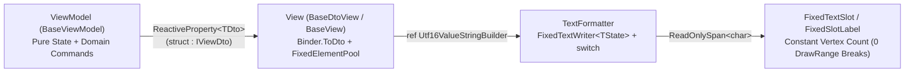

# SUIF DTO Standard & Zero-Realloc UI Architecture

> **Status:** Official SUIF Framework Standard (`com.reenbo.suif`)
> **Target Engine:** Unity 6+ UI Toolkit (`UnityEngine.UIElements`)

---

## 1. Why the DTO Standard Exists

In standard MVVM UI implementations, two architectural problems frequently degrade both code maintainability and runtime frame pacing:

1. **Visual Clutter in ViewModels & Views:** ViewModels build formatted display strings (`$"HP: {hp}/{maxHp}"`), construct hex codes, or select status labels. Views mix data transformation with UI Toolkit binding, making localization, theme switching, and unit testing difficult.
2. **`AllocPage` Fragmentation in UI Toolkit:** Changing a `Label.text` string to a different length changes the number of generated font quads in Unity's UIR renderer (`MeshHandle`). When vertex/index counts grow or shrink dynamically, UI Toolkit invalidates contiguous `AllocPage` vertex buffer slots, allocates new buffers, and splits `DrawRange` batches—multiplying Draw Calls (`14–46 DC` instead of `2–4 DC`) and causing GC pressure.

The **SUIF DTO Standard** solves both problems simultaneously by enforcing a strict 4-layer data pipeline paired with fixed-capacity GPU mesh primitives.

---

## 2. The 4-Layer Data & Rendering Pipeline



| Layer | Responsibility | Strictly Prohibited |
| :--- | :--- | :--- |
| **1. DTO Contracts** (`struct : IViewDto`, `enum`) | Immutable value-type snapshots (`readonly struct`) representing UI state via strongly-typed fields and enums. | `UnityEngine.UIElements` references, pre-formatted UI strings, mutable reference collections. |
| **2. ViewModel** (`BaseViewModel`) | Holds domain state, coordinates services, emits `ReactiveProperty<TDto>`, handles commands. | String interpolation (`$"..."`), `ZString.Format`, CSS class names, RichText tags, `Label` / `VisualElement` types. |
| **3. Text Formatter** (`static class`) | Pure `FixedTextWriter<TState>` methods writing into `ref Utf16ValueStringBuilder` + zero-alloc `switch` expressions returning interned constants for enums. | Returning heap-allocated `string` per tick or update when formatting dynamic labels. |
| **4. View** (`BaseDtoView<TViewModel, TDto>` / `BaseView<TViewModel>`) | Subscribes via `Binder.ToDto(...)`, toggles USS modifier classes, updates `FixedTextSlot` / `FixedSlotLabel`, and recycles DOM nodes via `FixedElementPool<TElement>`. | Domain/business calculations, per-click `container.Clear()` + `Add()`, raw `Label.text = $"..."` on dynamic labels. |

---

## 3. Core SUIF Framework Primitives

### 3.1 `IViewDto` & `BaseDtoView<TViewModel, TDto>`

* `SUIF.API.IViewDto`: Marker interface for typed view state structs.
* `SUIF.Base.BaseDtoView<TViewModel, TDto>`: Abstract view base constrained to `where TViewModel : class, IViewModel` and `where TDto : struct, IViewDto`, providing `protected abstract void RenderDto(in TDto dto)`.
* `SUIF.R3.Extensions.DtoBindingExtensions`: Zero-closure reactive binding helpers on `ViewBinder`:
  * `Binder.ToDto<TDto>(Observable<TDto> property, Action<TDto> onChanged)`
  * `Binder.ToDto<TDto, TState>(Observable<TDto> property, TState state, Action<TDto, TState> onChanged)`

### 3.2 `FixedTextSlot` & `FixedSlotLabel`

Located in `SUIF.Binding` and `SUIF.Controls`:

* **`FixedTextSlot`**: Wraps any `TextElement` (`Label`, `Button`, etc.) with a fixed character capacity (`capacity`, default `32`).
  * Incoming text is padded up to `capacity` inside a `<size=0.01>000...</size>` suffix so Flexbox layout keeps its natural tight width without expanding empty space.
  * During `PostProcessTextVertices`, padding glyph quads beyond the visible `parsedVisibleLength` (stripped of RichText `<...>` tags) are snapped to a degenerate point and assigned `alpha = 0`.
  * Because total vertex and index counts stay constant (`cmd.indexCount`), UI Toolkit reuses the existing `AllocPage` slot in-place with **0 `DrawRange` breaks** and **0 heap allocations** (writes via `_target.SetText(_buffer, 0, writeIndex)`).
  * Supports `SetText(string)`, `SetText(ReadOnlySpan<char>)`, `SetFormat<T1>(...)`, `SetFormat<T1, T2>(...)`, and `SetWritten<TState>(TState state, FixedTextWriter<TState> writer)` using a thread-local `ZString` builder.
* **`FixedSlotLabel`**: Drop-in UXML control (`[UxmlElement("FixedSlotLabel")]`) with `[UxmlAttribute("capacity")] int Capacity`, exposing `SetFixedText`, `SetFixedFormat`, and `SetFixedWritten`.
* **`LabelBindingExtensions.ToFixedText`**: Reactive `ElementBunch<TElement>` extensions (`ToFixedText(Observable<string|int|long|float>, capacity, format)`).

> [!NOTE]
> Always size `capacity` to the worst-case visible glyph count (excluding `<color=...>` / `<b>` RichText tags and `\r`/`\n` newlines, which `FixedTextSlot` accounts for separately when tracking `emittedQuadCount` vs `parsedVisibleLength`).

### 3.3 `FixedElementPool<TElement>`

Located in `SUIF.Binding`:

* Pre-allocates `capacity` elements once during `Bind()` via `factory(int index)` and adds them to `container` up front.
* Updates active slices on state change without DOM destruction:
  * `Render(int activeCount, Action<TElement, int> onBind)`
  * `Render<TState>(int activeCount, TState state, Action<TElement, int, TState> onBind)` *(zero-closure overload)*
* Uses `DisplayStyle.Flex` / `DisplayStyle.None` by default so inactive slots leave the layout cleanly without forcing dynamic vertex buffer reallocations across frames.

> [!IMPORTANT]
> Keep `DisplayStyle.None` for pooled/cached inactive views rather than `Visibility.Hidden`. Measured Play Mode profiling on cached windows showed that `Visibility.Hidden` retains hidden geometry in the render tree and spikes Draw Calls on restore (`27 DC` vs `16 DC` with `DisplayStyle.None`).

---

## 4. Reference Implementation Pattern

### Step 1: Define Typed DTO Contract
```csharp
using SUIF.API;

namespace MyGame.UI.Contracts
{
    public enum InventoryRarity : byte
    {
        Common,
        Rare,
        Legendary
    }

    public readonly struct InventoryInspectorDto : IViewDto
    {
        public readonly int ItemId;
        public readonly int PowerScore;
        public readonly InventoryRarity Rarity;

        public InventoryInspectorDto(int itemId, int powerScore, InventoryRarity rarity)
        {
            ItemId = itemId;
            PowerScore = powerScore;
            Rarity = rarity;
        }
    }
}
```

### Step 2: Emit DTO from ViewModel (Zero UI Strings)
```csharp
using R3;
using SUIF.Base;

namespace MyGame.UI.Inventory
{
    public sealed class InventoryViewModel : BaseViewModel
    {
        public ReactiveProperty<InventoryInspectorDto> State { get; } = new(
            new InventoryInspectorDto(101, 320, InventoryRarity.Rare));

        public void SelectItem(int itemId, int powerScore, InventoryRarity rarity)
        {
            State.Value = new InventoryInspectorDto(itemId, powerScore, rarity);
        }

        public override void Dispose()
        {
            State.Dispose();
        }
    }
}
```

### Step 3: Format Text in a Dedicated `FixedTextWriter<TState>` Formatter
```csharp
using Cysharp.Text;

namespace MyGame.UI.Formatting
{
    public static class InventoryTextFormatter
    {
        public static void WritePowerScore(ref Utf16ValueStringBuilder builder, InventoryInspectorDto dto)
        {
            builder.Append('+');
            builder.Append(dto.PowerScore);
            builder.Append(" PWR");
        }

        public static string GetRarityToken(InventoryRarity rarity) => rarity switch
        {
            InventoryRarity.Rare => "[RARE]",
            InventoryRarity.Legendary => "[LEGENDARY]",
            _ => "[COMMON]"
        };
    }
}
```

### Step 4: Render DTO in View (`BaseDtoView` + `FixedTextSlot`)
```csharp
using SUIF.Attributes;
using SUIF.Base;
using SUIF.Binding;
using SUIF.R3.Extensions;
using UnityEngine.UIElements;

namespace MyGame.UI.Inventory
{
    [UIView("InventoryView", SUIF.API.UILayer.Windows)]
    public sealed class InventoryView : BaseDtoView<InventoryViewModel, InventoryInspectorDto>
    {
        [UQuery("lbl-rarity")] private Label _rarityLabel;
        [UQuery("lbl-power")] private Label _powerLabel;

        private FixedTextSlot _raritySlot;
        private FixedTextSlot _powerSlot;

        public InventoryView(VisualElement root) : base(root) { }

        protected override void Bind()
        {
            _raritySlot = new FixedTextSlot(_rarityLabel, capacity: 16);
            _powerSlot = new FixedTextSlot(_powerLabel, capacity: 16);
            AddDisposable(_raritySlot);
            AddDisposable(_powerSlot);

            Binder.ToDto(ViewModel.State, this, static (dto, view) => view.RenderDto(in dto));
        }

        protected override void RenderDto(in InventoryInspectorDto dto)
        {
            _raritySlot.SetText(InventoryTextFormatter.GetRarityToken(dto.Rarity));
            _powerSlot.SetWritten(dto, InventoryTextFormatter.WritePowerScore);
        }
    }
}
```

---

## 5. Measured Production Results (`SUIF_APPEARENCE` Showcase)

Validated across all 6 Showcase modules in Unity 6 (`DX12` Play Mode + automated `8s` benchmark):

* **Draw Calls (Settled):** Reduced from `12–46 DC` spikes down to **`2–4 DC`** across Frame, Theme Switcher, Lifecycle, Reactive Counter, Inventory, and Modal overlays.
* **Frame Rate & GC:** **`457.3 FPS`** average (`2.19 ms` frame time, `271.5 FPS` 1% low) with **`0.007 MB` (~7 KB)** total managed allocation across **`3,663` frames**.
* **Batch Stability:** Dynamic text updates, button diagonal wipes, and pooled log/inventory slot switching produce **0 `DrawRange` splits** and **0 console errors**.

---

## 6. Anti-Patterns Checklist

* **NEVER** assign raw interpolated strings (`_label.text = $"HP: {hp}"`) on dynamically changing UI labels—always use `FixedTextSlot`, `FixedSlotLabel`, or `ToFixedText`.
* **NEVER** return formatted UI sentences or color/style strings from a ViewModel—emit a `struct : IViewDto` containing domain primitives and enums.
* **NEVER** allocate heap closures in `Binder.ToDto`, `FixedElementPool.Render`, or `FixedTextSlot.SetWritten`—pass `this` or the DTO via the `TState` parameter and use `static` lambdas or method groups.
* **NEVER** call `container.Clear()` + `new VisualElement()` on repeated list/log updates—pre-allocate a `FixedElementPool<TElement>` once in `Bind()`.
