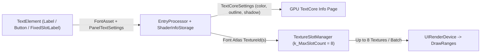

# Font Batching & PanelTextSettings Standard (Unity 6 UI Toolkit)

> **Status:** Official SUIF Framework Standard (`com.reenbo.suif`)
> **Target Engine:** Unity 6+ UI Toolkit (`UnityEngine.UIElements`)

---

## 1. How Unity 6 UI Toolkit Batches Text

Unlike legacy uGUI (where mixing UI quads and TextMesh Pro often creates material boundaries), Unity 6 UI Toolkit renders solid geometry, textures/atlases, and TextCore text through a single unified default shader (`Hidden/Internal-UIRDefault`).



### Key Rendering Internals (Unity 6)

1. **`TextureSlotManager` & the 8-Slot Uber-Shader Budget**:
   * `TextureSlotManager` allocates **`k_MaxSlotCount = 8`** concurrent texture slots per draw-range batch (`k_SlotSize = 2` `Vector4` entries per slot encoding texture dimensions, `sdfScale`, `sharpness`, and `isPremultiplied` mapped by `TextureId`).
   * Every simultaneously visible texture shares those **8** slots: the Panel Dynamic Atlas, standalone un-atlased textures, your primary `FontAsset` atlas texture, plus any fallback fonts, `fontWeightTable` assets, multi-atlas pages, or emoji/sprite atlases.
   * When distinct active textures overflow the available slots, `UIRenderDevice` flushes the batch with **`KickRangesReason.TextureSlotsExhausted`**, multiplying Draw Calls.
2. **Per-Element Effects Batch Free (`ShaderInfoStorage`)**:
   * `TextCoreSettings` (`faceColor`, `outlineColor`, `outlineWidth`, `underlayColor`, `underlayOffset`, `underlaySoftness`) live in GPU shader info pages (`s_TextCorePagePosID`), not separate `Material` instances.
   * Result: Multiple `Label`s with different `color`s, `font-size`s, outlines, and shadows that share **one** SDF `FontAsset` batch into **1 Draw Call**.
3. **Why Batching Still Breaks in Practice (`KickRangesReason`)**:
   * **`TextureSlotsExhausted`**: Mixing multiple fonts, OS fallbacks (`Arial`, `Microsoft YaHei`), multi-atlas overflow pages, or extra weight atlases.
   * **`PageChange`**: Dynamic text edits resizing `AllocPage` vertex buffers (prevented by `FixedTextSlot` / `FixedSlotLabel`).
   * **`StencilRefChange` / `ScissorChange`**: `overflow: hidden` + transforms or `<ui:ScrollView>` clipping boundaries.
   * **`MaterialChange` / `DefaultMaterialChange`**: Custom per-element `Material` overrides.

---

## 2. Mandatory Configuration Rules

### 2.1. `-unity-font-definition` & Explicit `PanelTextSettings`
* Always assign an explicit **`PanelTextSettings`** asset to `PanelSettings.textSettings` (`ShowcasePanelTextSettings.asset` in host projects) and set its **`defaultFontAsset`** to your primary SDF `FontAsset`.
* In USS/TSS, always use **`-unity-font-definition: url("...")`** referencing a TextCore `FontAsset` (`.asset`).
* **Never** use legacy **`-unity-font`** with raw `.ttf`/`.otf` `Font` assets, and never leave `PanelSettings.textSettings = null` (which triggers OS fallback discovery that differs between Windows Editor and headless Linux WebGL builders).

### 2.2. `GlyphRenderMode.SDFAA` & Valid Padding
* Configure UI Toolkit `FontAsset`s with **`Atlas Render Mode = SDFAA`** (or `SDFAA_HINTED` / `SDF16`) and **`Sampling Point Size` / `Atlas Padding` between `5` and `9` px**.
* **Never leave `atlasPadding == 0`**: zero padding prevents proper SDF distance field spread, degrading antialiasing and corrupting outlines/shadows.
* Avoid bitmap modes (`RASTER*`, `SMOOTH*`) when typography spans multiple `font-size` tiers, as every distinct font size rasterizes separate glyph bitmaps.

### 2.3. Unity 6.5+/6.6 ATG: Pre-Populated `Dynamic` & Single-Atlas Consolidation
In Unity 6.5+ / 6.6 (`6000.6.7f1`), UI Toolkit enables the **Advanced Text Generator (ATG)** by default, which **rejects `AtlasPopulationMode.Static`** (`"Advanced text system cannot render using static font asset"`).

* For bounded UI character sets (ASCII, Cyrillic, fixed localization alphabets, curated HUD icons):
  * Set **`Atlas Population Mode = Dynamic`** and assign **`sourceFontFile`** (`.otf` / `.ttf`).
  * **Pre-populate all required glyphs upfront** (`TryAddCharacters`) into a serialized single atlas texture (`Apply(false, false)`).
  * Set **`isMultiAtlasTexturesEnabled = false`** (`atlasTextures.Length == 1`) and **`PanelTextSettings.clearDynamicDataOnBuild = false`** so pre-baked glyphs survive player/WebGL builds with **0 ms** runtime rasterization.
* **Strictly forbid `Static` (under ATG) and `DynamicOS`** or reliance on OS fallback fonts (`Arial`, `Microsoft YaHei`): headless Linux CI (`ubuntu-latest`) lacks Windows OS fonts, causing missing characters on WebGL builds and extra runtime atlas allocations locally.

### 2.4. Font Weights (`fontWeightTable`) vs Synthetic Styles
* For ultra-low-Draw-Call WebGL2 / mobile panels, leave `fontWeightTable` empty on the primary `FontAsset` and use `-unity-font-style: bold` / `italic` (synthesized cleanly in the SDF shader on the same atlas).
* If separate weight/mono fonts are strictly required artistically, cap simultaneously visible `FontAsset` atlas textures at **`<= 2`**.

### 2.5. RichText, Symbols & `AllocPage` Discipline
* Avoid inline `<font="...">` and `<sprite=...>` tags inside hot dynamic labels; each tag switch forces a separate `RenderChainCommand` and `TextureId`.
* Audit `.uxml` and C# formatters for non-ASCII symbols missing from `sourceFontFile` / `FontAsset.characterTable` (e.g., geometric bullets/arrows `●`, `↻`, `■`, `┼`, `▲`, `▼`, `═`, `◢`, `◣`). Keep only natively supported glyphs baked into your primary single atlas, or replace missing symbols with ASCII tokens / GPU-batched `MeshGenerationContext.Allocate` geometry.
* Pair pre-populated single-atlas `Dynamic` `SDFAA` fonts with `FixedTextSlot` / `FixedSlotLabel` so dynamic HUD numbers and status lines never shift `AllocPage` allocations.

---

## 3. WebGL2 Determinism & Pre-Flight Steps

```css
/* ✅ Standard SUIF USS typography rule */
.unity-text-element {
    -unity-font: none;
    -unity-font-definition: url("../Fonts/Primary-Regular SDF.asset");
}
```

1. **Create & Assign `PanelTextSettings`**: Create a `PanelTextSettings` asset (`Assets/Settings/`), assign `defaultFontAsset`, set `clearDynamicDataOnBuild = false`, set `enableEmojiSupport = false` unless needed, and wire it into `PanelSettings.textSettings`.
2. **Audit Non-ASCII Glyphs**: Scan all `.uxml` and C# text formatters for `[^\x00-\x7F]` glyphs and verify every glyph exists in `FontAsset.characterTable`.
3. **Verify Single Atlas**: Confirm in Unity Inspector / Editor diagnostics that `atlasPopulationMode == Dynamic`, `sourceFontFile != null`, `atlasRenderMode == SDFAA`, `atlasPadding >= 5`, `isMultiAtlasTexturesEnabled == false`, and `atlasTextures.Length == 1`.
4. **Profile Live Batches**: Verify `UIRenderDevice.GatherDrawStatistics()` (`drawRangeCallCount`) and **UI Toolkit Debugger -> Texture Atlas Viewer** show only 1 primary font atlas and zero OS fallback atlases (`Arial`, `Microsoft YaHei`) and `0` ATG static-font errors.

---

## 4. Anti-Patterns Checklist

* **NEVER** leave `PanelSettings.textSettings` unassigned (`null`).
* **NEVER** use `-unity-font` pointing to raw `.ttf`/`.otf` files in runtime USS/TSS.
* **NEVER** ship UI `FontAsset`s with `atlasPopulationMode = Static` (under Unity 6.5+/6.6 ATG), `DynamicOS`, or `atlasPadding = 0`.
* **NEVER** leave unbaked non-ASCII symbols in UXML/C# that silently trigger OS fallback font atlases.
* **NEVER** allow more than 2 distinct font atlas textures on screen simultaneously when targeting minimal Draw Calls.
